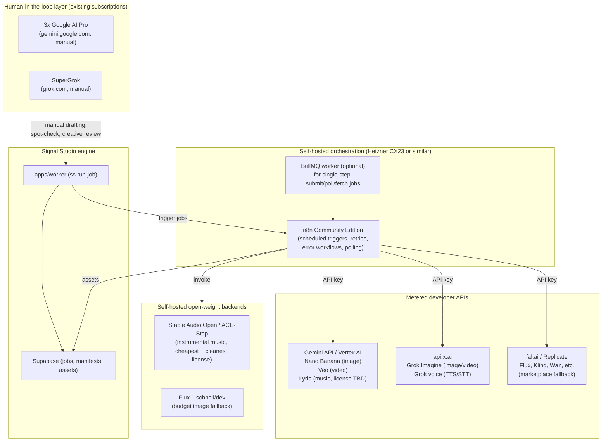

# Subscriptions won't power the pipeline — APIs will

> **Corrections (2026-10-15), read before acting on this report.** Researched 2026-10-15; the
> decision it fed is `docs/decisions/ADR-002-background-music.md`.
>
> - **Hosting:** the engine runs on a GCP VM (`34.14.146.86`), not a Hetzner CX23. That account
>   closed on 2026-09-28. Read every "Hetzner" below as "the production VM".
> - **No n8n:** the engine's own worker + API already do the orchestration this report gives to
>   n8n (jobs, retries, logs, storage, approval gates). n8n is not planned.
> - **No local GPU:** neither the production VM nor the dev desktop has one, so "self-host
>   ACE-Step / Flux" means a rented cloud GPU, run as a batch. ADR-002's layer 3 is deferred.
> - **Stable Audio Open's licence:** sources disagreed (non-commercial vs. free under $1M
>   revenue). Check the model card before relying on it.

Automated, unattended image/video/audio generation **cannot be built on the user's three Google AI Pro seats or one SuperGrok subscription** — both are confirmed, convergent findings: consumer subscriptions grant in-app usage caps to a human in a browser, not API keys, API credits, or any sanctioned automation surface, and no official "pool three accounts" or "bridge subscription into a script" mechanism exists for either Google or xAI ([discuss.ai.google.dev](https://discuss.ai.google.dev/t/gemini-subscription-access-for-third-party-apps-is-a-sanctioned-program-planned/175577), [CloudZero on xAI billing separation](https://www.cloudzero.com/blog/grok-pricing/)). The only path that reliably produces unattended, scheduled, ToS-compliant image, video, and audio generation is the **metered developer API + self-hosted orchestration** route: Gemini API (Nano Banana for images, Veo for video, Lyria for music), xAI's api.x.ai (Grok Imagine images/video, Grok voice), fal.ai/Replicate as multi-vendor marketplaces, and open-weight self-hosting (Flux, Stable Audio Open, ACE-Step) for the cheapest, legally cleanest tier of image and music generation. Browser automation of the Gemini or Grok web apps is technically possible but sits on fragile ground on every axis simultaneously — bot-detection walls that get strictly harder over time, session-cookie expiry that breaks working pipelines with no code change, and general ToS clauses (scraping, "bypassing systems," multi-account circumvention) that plausibly cover exactly this use case even though no provider names "browser-automating our consumer app" in so many words. Running the three Google accounts or the SuperGrok account in parallel for throughput is not a sanctioned feature either — it is, at best, an inference from thin multi-account-abuse language that Google and xAI have not specifically written with generative-AI-quota-stacking in mind, which makes it a real-but-unquantified risk rather than a green light. The economically and legally soundest design reuses the subscriptions only for what they're actually good at — human-in-the-loop drafting, prompt iteration, creative review — and routes all unattended production generation through billed APIs orchestrated by self-hosted n8n, landing on a monthly cost in the tens of dollars for a modest content cadence, with music being the one category where self-hosting an open-weight model is unambiguously both cheapest and legally cleanest at any volume.

## Consumer subscriptions are sealed off from automation by design, not by accident

The crux of this report is a distinction the research confirms sharply: Google AI Pro/Ultra and SuperGrok are **consumer entitlements** — capped daily/compute-based access to Nano Banana, Veo, and Grok Imagine inside a logged-in web or mobile session — and neither bundles any API key, API credit balance, or programmatic access of any kind. A Google AI Studio developer-forum thread states plainly there is "no sanctioned program" for third-party apps to use a consumer subscription on a user's behalf ([discuss.ai.google.dev](https://discuss.ai.google.dev/t/gemini-subscription-access-for-third-party-apps-is-a-sanctioned-program-planned/175577)), and a UK subscriber on the same forum reported that despite holding AI Pro, Google issued them only a free-tier API key, not a paid one ([discuss.ai.google.dev](https://discuss.ai.google.dev/t/can-not-obatin-api-key-subcribed-to-the-google-ai-pro-package-and-in-uk/124857)). On the xAI side, every source agrees the developer API (api.x.ai) and SuperGrok are "completely separate billing tracks" ([CloudZero](https://www.cloudzero.com/blog/grok-pricing/); [AI-Toolbox](https://ai-toolbox.co/grok-models/grok-pricing-plans-api-2026)) — the one community project that tried to route API-shaped requests through a SuperGrok OAuth session (`pi-grok`/"Hermes Agent") documents its own backend being actively blocked with HTTP 403 for standard subscribers, and recommends falling back to a real API key ([GitHub: stnly/pi-grok](https://github.com/stnly/pi-grok)). That a hobbyist workaround exists and is actively fought by xAI's own infrastructure is itself evidence the separation is deliberate, not an oversight.

Even the in-app entitlements themselves are murkier than marketing suggests. Third-party trackers (not Google's own primary pages, which returned stale or incomplete content to this research's fetch tooling) put Google AI Pro ($19.99/mo) at roughly 100 Nano Banana images/day and 3 Veo 3.1 Fast clips/day, with AI Ultra ($99.99–$249.99/mo, sources disagree even on price) multiplying those caps 5–20x and adding a "Deep Think" reasoning mode ([Gemini Usage Limits Explained, March 2026](https://ai.zenken.co.jp/en/post/gemini-usage/); [9to5Google](https://9to5google.com/2026/02/21/google-ai-pro-ultra-features/)). One tracker claims Google is mid-transition from flat daily quotas to a shared "compute-based" credit pool (1,000 credits for Pro, 35,000 for Ultra) during 2026 ([ai-toolbox.co](https://www.ai-toolbox.co/gemini-management-and-productivity/gemini-usage-limits-2026); [pricepertoken.com](https://pricepertoken.com/subscriptions/gemini)) — **Needs Clarification**, since no Google-primary source was retrieved confirming this. No source found any evidence that Lyria (Google's music model) is bundled into the consumer Gemini app at all — it appears to exist only as a paid API/Vertex AI product, meaning the "three Google AI Pro subscriptions" give zero path to automated instrumental music regardless of automation method. On SuperGrok, xAI's own pricing page confirms image/video generation is included but, notably, publishes no numeric quotas at all — only qualitative language like "higher rate limits" — while every specific number found (20+ videos/24h, 200 images/day, a "fair use algorithm" with 2–24-hour reset windows) traces to a single secondhand blog citing an alleged leaked support email, not an xAI publication ([AtlasCloud blog](https://www.atlascloud.ai/blog/guides/grok-xai-image-generation-daily-limit)) — flagged explicitly as **Needs Clarification** throughout this report wherever it recurs.

## Multi-account parallelism is inferred risk, not assumed-safe capacity

A natural instinct with three Google AI Pro seats and one SuperGrok seat is to run them in parallel for throughput — but the research is unambiguous that this is not a sanctioned capability, and should not be treated as free capacity. There is no technical blocker to being logged into three separate Google accounts in three browser profiles simultaneously, and no official statement says "you may not do this" in so many words — but Google's Gmail Program Policies explicitly bar using "multiple accounts to abuse Google policies, bypass account limitations, circumvent filters, or otherwise subvert restrictions placed on your account" ([Gmail Program Policies](https://www.google.ca/gmail/about/policy)), and Google Ads' much more detailed "Circumventing systems" policy treats exactly this pattern — spreading usage across multiple owned accounts to multiply what a single account is allowed — as grounds for suspension "upon detection and without prior warning" ([Google Ads Policy](https://support.google.com/adspolicy/answer/15938075?hl=en)). No Google-published policy names "three AI Pro subscriptions run in parallel for generation throughput" as its own scenario, so the researchers' conclusion that this would likely be read as "subverting restrictions placed on your account" is an **inference by analogy, not a quoted rule** — but it is the inference Google's own, much more detailed enforcement regime in an adjacent product area (Ads) would predict. The same caution applies to X/Grok: no enforcement case study specific to parallel SuperGrok sessions was found, and the general X ToS "published interfaces only" + anti-scraping clause could not be directly confirmed in this research (fetches returned HTTP 403), leaving the exact current wording as a confirmed gap rather than a settled fact.

Practically, this means the three Google AI Pro seats and the SuperGrok seat should be treated as **human-use entitlements for drafting, iteration, and spot-checking** — a person opening gemini.google.com or grok.com to sanity-check a prompt, generate a one-off asset, or do creative exploration — not as three or four multiplied slots of unattended automation capacity. Any design that scripts logins across all four accounts to run in parallel, unattended, on a schedule, converts a reasonably low-risk human workflow into a multi-account circumvention pattern that both Google's and xAI's general-purpose anti-abuse language plausibly covers, compounding whatever base ToS risk a single-account automation attempt would already carry (see below). This report does not recommend that architecture, consistent with the brief's instruction not to suggest ToS circumvention.

## Browser automation fails on three independent axes, and the failure gets worse with time

Even setting aside ToS language, the operational case against browser-automating Gemini or Grok's consumer web apps is strong on its own. The tooling landscape itself is a reliability signal: there is no mature, actively maintained, purpose-built product for scheduled automation of ChatGPT/Gemini/Grok web UIs — only generic frameworks (Playwright, Selenium, the newer `browser-use` agent framework) repurposed by small, often-stale hobby wrappers, several of which carry their own maintainer disclaimers about fragility and ToS risk ([sourcepulse.org on unofficial-chatgpt-api](https://www.sourcepulse.org/projects/1830729); [GitHub: ryuseisan/auto-chatgpt](https://github.com/ryuseisan/auto-chatgpt)). If this worked robustly and durably at scale, a popular, maintained tool would very likely already exist; its absence is itself informative. The reported failure modes cluster into three uncorrelated categories, each independently corroborated: **DOM/selector fragility** (hobby wrappers break whenever the provider redesigns its UI — explicitly acknowledged by at least one maintainer); **session/trust-signal expiry** (Cloudflare's bot-challenge system weighs accumulated trust cookies and behavioral fingerprinting, meaning a pipeline that worked yesterday can be challenged today with zero code changes — documented concretely when OpenAI's own first-party "ChatGPT Agent" lost a previously-working Cloudflare bypass within about two months, per a user report on OpenAI's community forum ([itc.ua](https://itc.ua/en/news/new-chatgpt-ai-agent-proves-that-it-is-not-a-robot-cloudflare-trusted-it-without-captcha); [OpenAI community thread](https://community.openai.com/t/chatgpt-agent-not-passing-cloudflare-verification-for-chatgpt-com/1336765))); and **driver/framework-level fingerprinting**, where Cloudflare has been reported to block the Selenium webdriver itself, independent of session state ([OpenAI community: "UI automation with ChatGPT"](https://community.openai.com/t/ui-automation-with-chatgpt/62684)). Cloudflare is also moving toward deeper behavioral analysis (mouse-click pattern study) specifically to catch bots, meaning this should be expected to get harder, not easier, over time ([sdxcentral](https://www.sdxcentral.com/news/cloudflare-now-studies-your-mouse-clicks-in-captcha-bot-gambit/)).

Layered on top of operational fragility is the ToS layer, and here the pattern is consistent across every provider examined: the consumer web/chat surface prohibits bot/script access, and the officially sanctioned route for programmatic use is the paid API. Anthropic's Consumer Terms (directly fetched, current) are the clearest primary-source example — barring automated/bot/script access "except when you are accessing our Services via an Anthropic API Key" ([Anthropic Consumer Terms](https://www.anthropic.com/legal/consumer-terms)) — and while Google's and xAI's exact current consumer-app clauses on automation could not be directly fetched in this research (both returned errors to the fetch tooling, so this is a genuine **Needs Clarification** gap, not a confirmed absence), Google's general Terms of Service do confirmedly prohibit "automated means to access content... in violation of... robots.txt," "bypassing our systems or protective measures," and list "scraping content that doesn't belong to you" as explicit grounds for suspension ([Google Terms of Service](https://policies.google.com/terms)). No clause anywhere names "Playwright against gemini.google.com" specifically — the applicable prohibitions are general-purpose, and a scripted pipeline would plausibly fall under them by extension, which is an inference the research is careful to flag as such rather than present as settled law. Concretely for ban evidence: no source in this research produced a clean, provider-confirmed "we suspended this account specifically for browser-automating our consumer app" case study for Google, xAI, or OpenAI — ban notices are consistently generic, making root cause hard to confirm in any single reported case — but the absence of a smoking-gun case study is not the same as the activity being safe; it mostly reflects that ban notices don't explain themselves and this is a long-tail activity that doesn't generate large, well-documented enforcement stories the way mass-scraping lawsuits do.

## The compliant substitute already exists: official APIs through self-hosted orchestration

n8n is confirmed to have native, first-party nodes for Google Gemini (text, image, audio, video, and a separate Chat Model node for agent workflows) built entirely on official API keys from Google AI Studio or Google Cloud Console — not browser scraping ([n8n Gemini integration docs mirror](https://www.mintlify.com/n8n-io/n8n/integrations/ai/google-gemini)). Where no native node exists — fal.ai, Replicate, and (unconfirmed either way) Grok/Midjourney — fal.ai's own integration guide documents the standard fallback explicitly: three generic HTTP Request nodes (submit → poll status → fetch result) using a Header Auth credential against the fal API key ([fal.ai n8n guide](https://fal.ai/docs/model-apis/guides/n8n)), a pattern that transfers directly to Replicate's structurally similar submit/poll/fetch REST API. n8n's Community Edition self-hosts for free with unlimited executions under its "Sustainable Use License" — source-available, not OSI-approved open source, but unrestricted for internal/personal use; it only becomes a legal concern if the pipeline were resold as a hosted service to others, which is not this use case ([n8n.io/pricing](https://n8n.io/pricing/); [SSD Nodes license explainer](https://www.ssdnodes.com/learn/n8n-sustainable-use-license-explained)). Third-party estimates put a minimal self-hosted n8n VPS at roughly €4–€12/month, or $40–$100/month for a more production-realistic setup with backups and monitoring ([Sliplane n8n pricing blog](https://sliplane.io/blog/n8n-pricing)) — and since this project's production engine already runs on a Hetzner CX23, adding a self-hosted n8n container to that same box is the option best aligned with infrastructure already in motion, well below even n8n Cloud's entry-level €20/month tier. For a solo developer who already codes, the research also surfaces a code-first alternative worth naming: BullMQ (Redis-backed) is explicitly recommended by third-party comparisons as the right tool when "jobs are one step long" — which closely approximates a single generation-API submit/poll/fetch cycle — while Temporal is reserved for cases where a multi-step pipeline failing halfway has real cost and must survive restarts, at the price of meaningfully heavier self-hosting overhead (a Temporal server plus Postgres) ([devtoolreviews.com comparison](https://www.devtoolreviews.com/reviews/temporal-vs-inngest-vs-trigger-dev-vs-bullmq-2026)).

Pricing confirms this route is genuinely cheap, not just compliant. On images, Flux.1 schnell on Replicate is **$0.003/image** and Google's Nano Banana 2.1 is **$0.034/image** at 1K resolution, both confirmed directly from the vendors' own pricing pages ([replicate.com/pricing](https://replicate.com/pricing); [ai.google.dev/gemini-api/docs/pricing](https://ai.google.dev/gemini-api/docs/pricing)) — and Google has **fully shut down its old Imagen API**, redirecting developers to the Nano Banana family instead, a change significant enough that any prior design assuming "Imagen via fal" is now stale ([ai.google.dev/gemini-api/docs/imagen](https://ai.google.dev/gemini-api/docs/imagen)). On xAI's side, `grok-imagine-image` is **$0.02/image** and `grok-imagine-video-1.5-lite` is **$0.020/sec**, both confirmed from docs.x.ai's own model-pricing table ([docs.x.ai/docs/models](https://docs.x.ai/docs/models)) — xAI's API is, notably, the cheapest confirmed video-generation route found in this entire research pass. Video generally is the most expensive and least trustworthy category: fal.ai's own model page for Veo 3 shows two different stated rates ($0.20 vs $0.50/sec) on the same page, and third-party trackers cite Kling 3.0 Pro anywhere from $0.029/sec to $0.224/sec — an 8x spread for the supposedly same model ([fal.ai/models/fal-ai/veo3](https://fal.ai/models/fal-ai/veo3); [fal.ai learn guide](https://fal.ai/learn/tools/ai-video-generators)) — meaning every video price in this report must be re-fetched live before being hardcoded into pipeline config. On music, the picture is cleaner than anywhere else in the stack: Google's Lyria 2 is **$0.06 per 30 seconds** on Vertex AI (confirmed primary source) but with **no confirmed commercial-use license terms found anywhere** — a specific, flagged **Needs Clarification** gap that should be resolved before Lyria enters a monetized pipeline ([Google Cloud docs](https://docs.cloud.google.com/vertex-ai/generative-ai/docs/model-reference/lyria-music-generation)) — while **Stable Audio Open 1.0** (Apache-class Stability AI Community License, free commercial use under $1M revenue) and **ACE-Step** (Apache 2.0, confirmed from its own GitHub README, generating a full track in single-digit seconds on a rented RTX 4090) are both unambiguously free, legally clean, and fast enough to self-host as the pipeline's default instrumental-music backend ([stability.ai/license](https://stability.ai/license); [github.com/ace-step/ACE-Step](https://github.com/ace-step/ACE-Step)).

## Legal risk doesn't disappear with API access — it just moves from account-ban to IP indemnification

Switching to official APIs eliminates ToS/ban risk but surfaces a second, orthogonal risk this research flags consistently across every image and video vendor checked: **almost no self-serve API tier offers blanket indemnification against third-party infringement claims on generated output.** fal.ai's terms explicitly state it does not warrant outputs are original or non-infringing and places that risk on the customer ([fal.ai Terms of Service](https://www.fal.ai/legal/terms-of-service)); Black Forest Labs names "permissive commercial use" only at its Enterprise tier, not its self-serve Builder/Platform/Professional tiers ([bfl.ai/pricing](https://bfl.ai/pricing)); and OpenAI's standard API terms reportedly flow indemnification from the _customer_ to OpenAI, the reverse of the usual arrangement, with real indemnification protection reserved for Business/Enterprise agreements (unverified against OpenAI's primary terms in this pass — **Needs Clarification**). On music specifically, this risk is sharpest: ElevenLabs' archived music-specific terms prohibit outputs in ads, broadcast, film, and standalone resale even on paid tiers, with ambiguity over whether monetized YouTube/social content counts as "ads" ([elevenlabs.io archived terms](https://elevenlabs.io/eleven-music-v1-terms-archived-nov-21-2025)); Meta's MusicGen/AudioCraft weights are CC-BY-NC 4.0 (explicitly non-commercial) despite MIT-licensed code; Suno and Udio are both entangled in active or recently-settled major-label litigation with no confirmed public API or commercial terms suitable for this use case ([musicbusinessworldwide.com](https://www.musicbusinessworldwide.com/universal-music-settles-udio-lawsuit-strikes-deal-for-licensed-ai-music-platform)); and Mubert explicitly excludes Content ID matching and standalone streaming release from its license, a direct risk flag for any YouTube-monetized pipeline ([jackrighteous.com Mubert review](https://jackrighteous.com/blogs/music-creation-process-guide/mubert-ai-review-licensing-limits-and-best-uses-for-creators)). Midjourney should be ruled out entirely regardless of licensing, since it has no API and its own ToS explicitly states "You may not use automated tools to access, interact with, or generate Assets" ([via myarchitectai.com](https://www.myarchitectai.com/blog/midjourney-apis)) — the one provider in this research where the automation ban is quoted directly and unambiguously, not inferred.

## Recommended architecture



The design routes every **unattended, scheduled** generation call through a billed API — Gemini API for Google-quality image/video needs plus Veo, xAI's api.x.ai for Grok Imagine image/video and voice, fal.ai/Replicate as a multi-vendor fallback marketplace when a specific model isn't natively available from its own vendor — all orchestrated by a self-hosted n8n instance using its native Gemini/OpenAI nodes and the documented HTTP-Request submit/poll/fetch pattern for anything without a native node. Music runs through a self-hosted Stable Audio Open or ACE-Step instance as the default, with Lyria held in reserve pending resolution of its commercial-license gap. The three Google AI Pro and one SuperGrok subscription sit outside the automated loop entirely, reserved for a human to draft prompts, do one-off creative generation, or sanity-check outputs manually in a browser — the one use those subscriptions are actually, confirmedly licensed for.

## Implementation phases

1. **Phase 0 — API account setup (no code).** Create a Gemini API key via Google AI Studio (separate from the AI Pro subscriptions — confirm it's billed per-use, not tied to consumer quota) and an api.x.ai key via console.x.ai. Budget for $25 of promotional xAI credit expiring in 30 days as a free trial window, not a production budget line.
2. **Phase 1 — Self-hosted n8n on existing infra.** Deploy n8n Community Edition as a container alongside the existing `docker/compose.prod.yml` stack on the Hetzner CX23, or a second cheap VPS if resource contention is a concern. Configure the native Gemini node and generic HTTP Request + Wait-node pattern for fal.ai/xAI.
3. **Phase 2 — Image pipeline MVP.** Wire a single n8n workflow: trigger → Flux.1 schnell (Replicate, $0.003/image) for drafts, Nano Banana 2.1 (Gemini API, $0.034/image) for publish-quality — store outputs to the existing Supabase/R2 asset pipeline.
4. **Phase 3 — Music backend.** Stand up Stable Audio Open or ACE-Step on a rented RunPod/Vast.ai GPU (RTX 4090, ~$0.34/hr), triggered on-demand by n8n rather than kept warm, given the bursty, non-continuous nature of this pipeline's generation volume.
5. **Phase 4 — Video pipeline.** Add a video-generation n8n workflow using the xAI Grok Imagine video API ($0.02–$0.08/sec, cheapest confirmed) as default, with Veo/Kling/fal fallback paths for cases where Grok's output quality or style doesn't fit; hardcode nothing — re-fetch live pricing at integration time given the 2–8x cross-source price discrepancies documented in this research.
6. **Phase 5 — Error handling and monitoring.** Configure n8n's workflow-level Error Trigger and per-node Retry On Fail settings; add alerting (e.g., to the existing engine's notification path) for generation failures, since `apps/worker`'s `jobs.error` pattern (per this repo's own recent P1.2 work) is a natural place to surface these.
7. **Phase 6 — Legal/licensing review gate.** Before any generated asset reaches a monetized public post, confirm the specific model/tier actually used carries commercial-use rights and, ideally, some indemnification — treat this as a go/no-go gate per asset type, not a one-time check, since license terms (per this research) change frequently and without much notice (Qwen-Image-2.1-Turbo's license change, ElevenLabs' archived vs. current music terms, and Google's Imagen shutdown all happened within the research window).

## Example workflow (image generation via n8n + fal.ai)

```json
{
  "workflow": "generate-image-fallback",
  "nodes": [
    { "type": "Schedule Trigger", "cron": "triggered by apps/worker job creation" },
    {
      "type": "HTTP Request",
      "name": "Submit to fal.ai queue",
      "method": "POST",
      "url": "https://queue.fal.run/fal-ai/flux/schnell",
      "auth": "Header Auth: Authorization: Key {{$credentials.falApiKey}}",
      "body": { "prompt": "{{$json.prompt}}", "image_size": "landscape_16_9" }
    },
    { "type": "Wait", "duration": "10s" },
    {
      "type": "HTTP Request",
      "name": "Poll status",
      "url": "https://queue.fal.run/fal-ai/flux/requests/{{$json.request_id}}/status"
    },
    { "type": "IF", "condition": "status == 'COMPLETED'" },
    {
      "type": "HTTP Request",
      "name": "Fetch result",
      "url": "https://queue.fal.run/fal-ai/flux/requests/{{$json.request_id}}"
    },
    { "type": "Supabase node", "action": "upload to R2 + record asset" }
  ],
  "error_workflow": "notify-engine-on-failure"
}
```

## Cost and reliability comparison

| Approach                                                    | Setup cost                      | Marginal cost/unit                                      | Reliability                                               | ToS risk                                      | Verdict                                        |
| ----------------------------------------------------------- | ------------------------------- | ------------------------------------------------------- | --------------------------------------------------------- | --------------------------------------------- | ---------------------------------------------- |
| Browser-automate Gemini/Grok consumer apps                  | Low (scripting effort)          | "Free" (within quota)                                   | Low — Cloudflare/session fragility, selector breakage     | Real, plausible per general ToS clauses       | Not recommended                                |
| 3-4 parallel consumer accounts, automated                   | Low-medium                      | "Free" (within quota)                                   | Low, same fragility x4                                    | Higher — multi-account circumvention language | Not recommended                                |
| Gemini API + xAI API + n8n orchestration                    | Low (VPS + n8n container)       | $0.003–$0.24/image, $0.02–$0.60/sec video               | High — official, documented, versioned                    | None (sanctioned route)                       | **Recommended production path**                |
| fal.ai/Replicate as fallback marketplace                    | None (pay-per-call)             | Comparable to above, 2-8x price variance across sources | High for availability, medium for price predictability    | None                                          | Recommended as supplement                      |
| Self-hosted open-weight (Flux, Stable Audio Open, ACE-Step) | GPU rental (~$0.34/hr RTX 4090) | Images ~$0.003-0.005; music near-free                   | High if utilization is steady; poor for bursty low-volume | None (Apache/Community license)               | Recommended for music always; images at volume |

## Final recommendation and action plan

1. **Immediately:** stop any plan to script or parallelize the Google AI Pro / SuperGrok consumer accounts for unattended generation; reassign them to human drafting/review use.
2. **This week:** provision a Gemini API key and an xAI API key as separate, independently-billed accounts; set small spending caps while validating the pipeline.
3. **This week:** deploy self-hosted n8n Community Edition on the existing Hetzner box.
4. **Next 2 weeks:** build and test the image-generation MVP (Flux.1 schnell → Nano Banana fallback) end-to-end into the existing Supabase/R2 asset flow.
5. **Next 2-4 weeks:** stand up a self-hosted Stable Audio Open or ACE-Step instance for background music, triggered on-demand (not kept warm).
6. **Within a month:** add video generation via xAI's Grok Imagine API as the cost-leading default, with a documented fallback to Veo/Kling/fal for quality gaps — re-verify live pricing before locking in any vendor.
7. **Ongoing, before every new asset type or vendor goes into the monetized publish path:** confirm current commercial-use license and indemnification status directly from the vendor's own terms page, not from this report's citations — several of the facts above (Imagen shutdown, Qwen license change, ElevenLabs music terms versioning) changed within the research window itself, which is the single clearest signal that license terms in this space are not static enough to trust indefinitely.

**MVP definition:** a single n8n workflow, triggered by `apps/worker`, that generates one image via Flux.1 schnell (Replicate) or Nano Banana (Gemini API), stores it to the existing asset pipeline, and alerts on failure — proving the submit/poll/fetch + error-handling pattern before extending to video and music.

## Conclusion

The research closes out a question that could have gone either way going in: whether paid consumer AI subscriptions quietly include some developer-facing door nobody advertises. They don't, on either side — Google and xAI have both drawn a hard, deliberate line between what a human pays $20-30/month to click through in a browser and what a backend can call programmatically, and the thinness of enforcement-specific language around multi-account and automation abuse for generative AI specifically (as opposed to Gmail spam or Ads circumvention, both long-codified) suggests this is simply a newer abuse pattern Google and xAI haven't needed to spell out yet, not one they've implicitly blessed. The practical implication for a budget-constrained solo pipeline is almost reassuring: the compliant path is also the cheap path. Per-unit API pricing for images and music is now cheap enough (fractions of a cent to a few cents) that the consumer subscriptions' theoretical "free" generation caps were never going to save meaningful money once reliability and risk are priced in — video remains the one category where cost is still high and volatile enough to warrant careful vendor selection and live price-checking at every integration point, a discipline this research's own repeated cross-source price conflicts (2x to 8x spreads for the same nominal model) makes non-optional rather than merely prudent.
